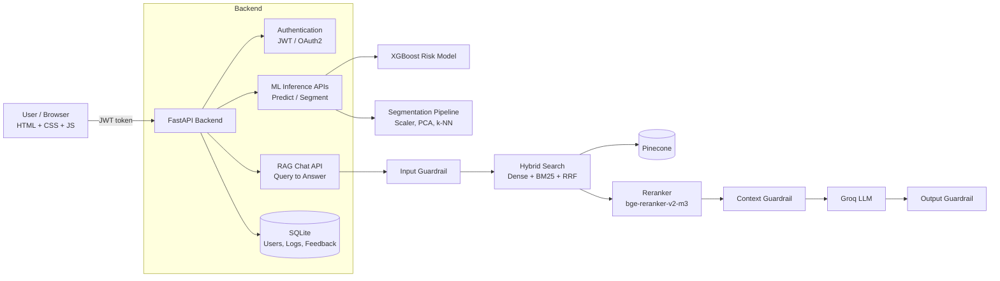

# 💠 FinSight AI: AI-Powered Financial Intelligence Platform

> An end-to-end AI platform for banking customers and lending teams. It estimates loan repayment risk, segments customers by financial behaviour, and answers finance questions from trusted documents using a guarded RAG assistant.

    

---

## 📌 Table of Contents
1. [Problem Statement](#-problem-statement)
2. [Objectives](#-objectives)
3. [Solution Overview](#-solution-overview)
4. [System Architecture](#-system-architecture)
5. [Features](#-features)
6. [Tech Stack](#-tech-stack)
7. [Datasets](#-datasets)
8. [Machine Learning Pipelines](#-machine-learning-pipelines)
9. [RAG Pipeline](#-rag-pipeline)
10. [Security and Guardrails](#-security-and-guardrails)
11. [Evaluation](#-evaluation)
12. [Backend API](#-backend-api)
13. [Frontend](#-frontend)
14. [Project Structure](#-project-structure)
15. [Setup and Installation](#-setup-and-installation)
16. [How to Run](#-how-to-run)
17. [Responsible AI and Limitations](#-responsible-ai-and-limitations)
18. [Author](#-author)

---

## 🎯 Problem Statement

Banks and lending teams work with large amounts of customer and transaction data, but turning it into decisions is slow and scattered across tools:

- **Lending teams** need a quick, data-driven view of how likely a borrower is to miss or delay repayments, so they can prioritise manual review.
- **Banks** treat customers as one group, which makes targeted offers and support hard. Customers need to be grouped by how they actually spend and borrow.
- **Customers and staff** often have simple finance questions (inflation, SIPs, credit, NPV) and have to search long documents for the answers.
- Unusual transactions and spending trends are hard to spot without analytics.

There is no single, easy-to-use platform that combines risk estimation, customer understanding and a trustworthy financial assistant.

## 🎯 Objectives

1. Build a **supervised model** that estimates the probability of serious loan delinquency.
2. Build an **unsupervised model** that groups credit-card customers into meaningful behaviour segments.
3. Build a **RAG assistant** that answers finance questions **only from trusted documents** and shows its sources.
4. Protect the platform with **authentication** and **AI guardrails**.
5. Deliver everything through a **FastAPI backend** and a clean, user-friendly **web interface**.

## 💡 Solution Overview

FinSight AI turns the problems above into five capabilities:

| Capability | AI approach | What it does | Status |
|---|---|---|---|
| Loan repayment risk | Supervised learning (XGBoost) | Predicts the probability that a borrower may miss or delay repayments | ✅ Live |
| Customer segmentation | Unsupervised learning (Agglomerative clustering) | Groups customers by spending and financial behaviour | ✅ Live |
| Financial assistant | RAG (Pinecone + Groq LLM) | Answers questions using trusted financial documents | ✅ Live |
| Transaction anomaly detection | Unsupervised learning (Isolation Forest) | Flags unusual transactions for further review | 🚧 Planned |
| Financial insights | Analytics | Shows income, expense, savings, debt and spending trends | 🚧 Planned |

> **Important:** The repayment model gives a *risk estimate to support human review*. It does not approve or reject loans automatically. Anomaly detection (planned) will flag transactions for investigation. It will not claim that fraud has occurred.

## 🏗 System Architecture



**Request flow:** the user logs in, receives a JWT, and the frontend sends it with every request. ML and RAG calls are logged to the database, and users can rate answers through the feedback endpoint.

## ✨ Features

- 🔐 **Secure login and registration** with JWT tokens and hashed passwords (Argon2)
- 📉 **Loan repayment risk estimate** with probability, risk bar and a human-review note
- 👥 **Customer segmentation** into four named behaviour groups
- 💬 **Financial assistant** with source citations (file name and page) and 👍/👎 feedback
- 🛡 **Guardrails** against prompt injection, PII exposure and prompt leakage
- 🧾 **Request history** stored per user and shown on the dashboard
- 📊 **RAGAS evaluation** of the RAG pipeline using a Groq LLM as the judge

## 🧰 Tech Stack

| Layer | Technologies |
|---|---|
| Frontend | HTML, CSS, JavaScript (no framework) |
| Backend | FastAPI, Uvicorn, Pydantic |
| Database | SQLite with SQLAlchemy |
| Authentication | JWT (PyJWT), OAuth2 password flow, Argon2 (pwdlib) |
| Supervised ML | XGBoost, scikit-learn, pandas, joblib |
| Unsupervised ML | scikit-learn (StandardScaler, PCA, Agglomerative clustering, k-NN) |
| RAG | LangChain, Pinecone (vector DB, hosted embeddings and reranker), BM25, Groq LLM |
| Evaluation | RAGAS |
| Package manager | uv |

## 📂 Datasets

| Purpose | Dataset | Notes |
|---|---|---|
| Loan repayment risk | [Give Me Some Credit](https://www.kaggle.com/competitions/GiveMeSomeCredit/data) (Kaggle) | ~150,000 borrowers, 10 features, about 6.7% positive class (serious delinquency in 2 years) |
| Customer segmentation | Credit Card Dataset for Clustering (Kaggle) | 8,950 credit-card customers, 17 behaviour features |
| RAG knowledge base | SEBI Financial Education Booklet, *Corporate Finance* (Berk and DeMarzo) | PDFs stored in `data/financial_data/` |

## 🤖 Machine Learning Pipelines

### 1. Loan repayment risk (supervised)

**Goal:** predict `SeriousDlqin2yrs` (the borrower had serious delinquency within two years).

**Steps**
1. Explore the data and check the class imbalance (about 93.3% negative, 6.7% positive).
2. Drop the index column and impute missing `MonthlyIncome` and `NumberOfDependents`.
3. Split into train, validation and test sets.
4. Compare Logistic Regression, Naive Bayes, Decision Tree, Random Forest and **XGBoost**.
5. Tune the decision **threshold** on the validation set to maximise F1, because accuracy is misleading on imbalanced data.
6. Save the model, threshold, feature list and imputation defaults in a single `credit_risk_xgb.joblib`.

**Test results (XGBoost)**

| Metric | Score |
|---|---|
| ROC-AUC | 0.864 |
| Precision | 0.385 |
| Recall | 0.528 |
| F1 | 0.445 |

**Note:-** The output class is imbalance so that's why the situation become "Bias-Variance tradeoff" when I was try to increases the precision the other metrics is decreases so the possible result(score) I achieved is given above.  

### 2. Customer segmentation (unsupervised)

**Goal:** group credit-card customers by spending and payment behaviour.

**Steps**
1. Clean the data and impute missing `CREDIT_LIMIT` (median) and `MINIMUM_PAYMENTS` (mean).
2. Scale features with `StandardScaler` and reduce dimensions with **PCA (3 components)**.
3. Cluster with **Agglomerative Clustering (4 clusters)**.
4. Profile each cluster using median feature values and give it a business name.
5. Agglomerative clustering cannot predict new customers, so a **k-NN classifier** is trained on its labels. The final saved pipeline is `StandardScaler → PCA → k-NN`, stored with the feature list and cluster names in `segment_model.joblib`.

**Discovered segments**

| Cluster | Segment | Customers | Typical behaviour |
|---|---|---|---|
| 0 | Frequent Spenders | 12.1% | High purchases (~3,400), buys very often, high credit limit |
| 1 | Low Usage Customers | 53.9% | Low purchases (~180), buys rarely |
| 2 | Cash Advance Users | 14.6% | No purchases, large cash advances (~3,270), high balance |
| 3 | Active Low-Balance Customers | 19.4% | Buys regularly in small amounts, very low balance (~208) |

## 🔎 RAG Pipeline

The assistant answers **only from the indexed documents**. If the answer is not there, it says so.

| Stage | Details |
|---|---|
| Ingestion | PDFs loaded with `PyPDFDirectoryLoader`, split with `RecursiveCharacterTextSplitter` (chunk size 400, overlap 100) |
| Embeddings | Pinecone hosted `llama-text-embed-v2` (1024 dimensions, cosine) |
| Vector store | Pinecone serverless index `financial`, uploaded in small batches to avoid rate limits |
| Hybrid search | Dense search plus BM25 keyword search (10 results each), merged with **Reciprocal Rank Fusion** into 20 candidates |
| Reranking | Pinecone hosted `bge-reranker-v2-m3` keeps the best 5 chunks |
| Generation | `RetrievalQA` ("stuff" chain) with a custom prompt and a Groq LLM (`openai/gpt-oss-120b`) |
| Output | Answer plus source documents (file and page) |

## 🛡 Security and Guardrails

**Authentication:** passwords are hashed with Argon2, logins return a short-lived JWT (30 minutes), and all ML and RAG endpoints need a valid token. Secrets are kept in `.env`.

**AI guardrails (`RAG_pipeline/Guardrails.py`)** run at three points:

1. **Input guard:** blocks prompt-injection and jailbreak patterns, limits length, and masks PII (email, PAN, Aadhaar, card and phone numbers) before it reaches the vector database or the LLM.
2. **Context guard:** removes retrieved chunks that contain hidden instructions (indirect prompt injection).
3. **Output guard:** blocks system-prompt leaks and masks PII in the answer.

## 📏 Evaluation

The RAG pipeline is evaluated with **RAGAS**, using a Groq LLM as the judge and Pinecone embeddings.

| Metric | What it checks |
|---|---|
| Faithfulness | Is the answer supported by the retrieved context? |
| Answer relevancy | Does the answer address the question? |
| Context precision | Are the retrieved chunks relevant? |
| Context recall | Did retrieval find what is needed to answer? |

The test set is a small, hand-built set of questions with ground truths written from the source PDFs. The `answer` and `contexts` fields come from the running pipeline.

| Metric | Score |
|---|---|
| Faithfulness | 88.8 |
| Answer relevancy | 50.4 |
| Context precision | 100 |
| Context recall | 90 |

## 🔌 Backend API

Interactive docs are available at `http://127.0.0.1:8000/docs` (Swagger UI).

| Method | Endpoint | Auth | Description |
|---|---|---|---|
| POST | `/auth/register` | No | Create an account |
| POST | `/auth/login` | No | Log in, returns a JWT |
| GET | `/users/me` | Yes | Current user profile |
| POST | `/ml/predict` | Yes | Loan repayment risk (probability and flag) |
| POST | `/ml/segment` | Yes | Customer segment (name, description, icon) |
| POST | `/rag/chat` | Yes | Ask the financial assistant (answer, sources, log id) |
| GET | `/logs` | Yes | My recent requests |
| POST | `/feedback` | Yes | Rate an answer from 1 to 5 |
| GET | `/feedback` | Yes | My submitted feedback |

## 🖥 Frontend

A responsive web app built with plain HTML, CSS and JavaScript:

- **Login and register** screen
- **Dashboard** with usage stats, feature cards and recent activity
- **Loan Risk** form with a risk percentage, progress bar and review note
- **Segmentation** form that shows the customer's segment
- **Assistant** chat with suggested questions, source chips and feedback buttons

**Colour palette:** `#253466` navy · `#8FB064` green · `#8DA4F0` periwinkle · `#DCE8CC` mint · `#9E2B93` plum

## 🗂 Project Structure

```
FinSight-AI/
├── backend/                    # FastAPI application
│   ├── main.py                 # App entry point, CORS, routers
│   ├── database.py             # SQLite connection
│   ├── models.py               # Tables: User, Log, Feedback
│   ├── schemas.py              # Request/response models
│   ├── crud.py                 # Database helper functions
│   ├── auth.py                 # Password hashing + JWT
│   └── routers/
│       ├── auth_routes.py      # Register / login
│       ├── ml_routes.py        # /ml/predict, /ml/segment
│       ├── rag_routes.py       # /rag/chat
│       └── data_routes.py      # Users, logs, feedback
├── frontend/                   # HTML, CSS, JS app
│   ├── index.html
│   ├── style.css
│   └── app.js
├── ML_pipeline/
│   ├── supervised_model.ipynb      # Loan risk (XGBoost)
│   ├── unsupervised_model.ipynb    # Customer segmentation
│  
├── RAG_pipeline/
│   ├── Ingestion.py            # PDFs → chunks → Pinecone
│   ├── Retrieval.py            # Hybrid search + rerank + QA chain
│   ├── Generation.py           # Command-line chat
│   ├── Guardrails.py           # Input / context / output guards
│   └── Ragas(Evalution).py     # RAGAS evaluation
├── data/financial_data/        # Source PDFs for the RAG assistant
├── credit_risk_xgb.joblib      # Saved loan-risk model bundle
├── segment_model.joblib        # Saved segmentation model
├── pyproject.toml
├── requirements.txt
└── README.md
```

## ⚙️ Setup and Installation

**Prerequisites:** Python 3.12, [uv](https://docs.astral.sh/uv/), a [Pinecone](https://www.pinecone.io/) account, and a [Groq](https://console.groq.com/) API key.

```bash
# 1. Clone the repository
git clone https://github.com/<your-username>/FinSight-AI.git
cd FinSight-AI

# 2. Install dependencies
uv sync
```

**3. Create a `.env` file in the project root:**
```env
PINECONE_API_KEY=your_pinecone_key
GROQ_API_KEY=your_groq_key
SECRET_KEY=your_long_random_string
```
Generate a secret key with:
```bash
python -c "import secrets; print(secrets.token_hex(32))"
```

**4. Build the vector database (run once):** put your PDFs in `data/financial_data/`, then:
```bash
uv run python RAG_pipeline/Ingestion.py
```

**5. Models:** run the notebooks in `ML_pipeline/` to produce `credit_risk_xgb.joblib` (project root) and `ML_pipeline/segment_model.joblib`.

## ▶️ How to Run

**Terminal 1: backend**
```bash
uv run uvicorn backend.main:app --reload
```
API docs: `http://127.0.0.1:8000/docs`

**Frontend:** open the `frontend/` folder in VS Code, right-click `index.html` and choose **Open with Live Server** (port 5500). Or from a second terminal:
```bash
cd frontend
uv run python -m http.server 5500
```
Then open `http://127.0.0.1:5500`, create an account and start using the app.

> The frontend must run on port **5500**, because the backend's CORS settings allow that address.


## ⚖️ Responsible AI and Limitations

- The risk score is a **decision-support estimate**, not a lending decision. A human should review every case.
- Model precision on the delinquency class is modest (0.385), so many flagged borrowers will not default. Use the result as a prioritisation signal.
- The segmentation model approximates Agglomerative clusters with k-NN, so customers near a cluster boundary may be assigned differently.
- Segment names are business interpretations of the discovered clusters, not labels from the dataset.
- The assistant only knows what is in the indexed PDFs, and its answers should be verified for important financial decisions.
- Regex-based guardrails catch common attacks but not every rewording.

## 👤 Author

**Affan Khan** · [GitHub](https://github.com/affankhan93)

Built as a portfolio project to demonstrate end-to-end data science: model training, RAG, API development, security and deployment-ready design. 
